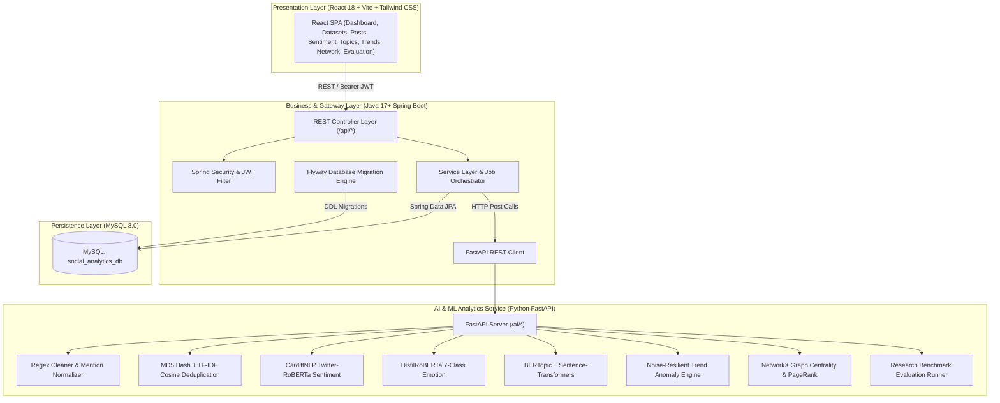
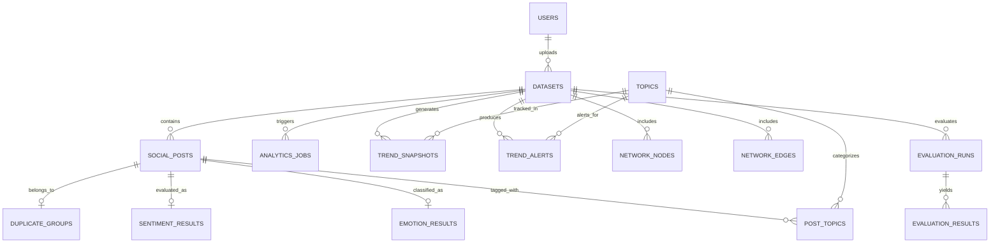

# AI-Powered Social Media Analytics Framework with Noise-Resilient Trend Detection

[](https://spring.io/projects/spring-boot)
[](https://www.python.org/)
[](https://fastapi.tiangolo.com/)
[](https://react.dev/)
[](https://www.mysql.com/)
[]()

> **B.Tech Computer Science and Engineering Minor Project**  
> **Academic Focus:** Investigating whether duplicate handling, temporal anomaly detection, and sentiment-shift analysis improve emerging-trend detection compared with simple post-volume-based methods.

---

## 1. Project Introduction

**SocialLens** is a full-stack social media analytics and machine learning platform engineered to identify public sentiment, extract discussion themes, and detect emerging trends with resilience against artificial bot spam and repetitive noise.

Unlike naive analytics dashboards that rank trends by raw post volume, SocialLens investigates a multi-signal approach that pairs natural language processing with temporal statistical anomaly detection.

---

## 2. Problem Statement

Conventional social media trend algorithms rank topics strictly by raw post frequency or percentage growth rate. This exposes platforms to critical vulnerabilities:
1. **Coordinated Bot Spikes**: Astroturfing campaigns repeatedly repost identical phrasing, artificially inflating raw volume counts.
2. **Low-Sample Spikes**: Percentage growth spikes erratically on small post counts (e.g. 1 post to 4 posts = +300% growth).
3. **Sentiment Blindness**: Raw volume fails to capture opinion divergence or public turning points.

---

## 3. Project Objectives

1. Ingest social media datasets in standard CSV and JSON formats with flexible schema column mapping.
2. Identify exact duplicates via MD5 hashing and near-duplicates via TF-IDF cosine similarity clustering ($\ge 0.85$).
3. Infer 3-class public sentiment using `cardiffnlp/twitter-roberta-base-sentiment-latest`.
4. Classify 7 distinct human emotions using `j-hartmann/emotion-english-distilroberta-base`.
5. Discover semantic topics dynamically using Sentence-Transformers (`all-MiniLM-L6-v2`) and class-based TF-IDF.
6. Compute noise-resilient trend scores comparing **Baseline A (Volume)**, **Baseline B (Growth)**, and the **Proposed Multi-Signal Method**.
7. Model social interaction networks (replies, mentions) using NetworkX PageRank and Betweenness Centrality.
8. Evaluate experimental precision, recall, F1-scores, false-alert rates, and detection delays.

---

## 4. Key Features

- **Multi-Format Ingestion**: Drag-and-drop CSV/JSON upload with live record preview and auto-detected column mappings.
- **Noise-Resilient Trend Engine**: Mathematical trend scoring incorporating duplicate dampening, rolling Z-score temporal anomalies, and sentiment divergence ($\Delta S$).
- **Evidence-Backed Trend Alerts**: Every alert contains current volume, baseline volume, growth percentage, duplicate spam ratio, and supporting post record IDs.
- **Deep-Dive Posts Explorer**: Filter posts by sentiment, platform, duplicate status (unique vs spam), and text search.
- **Topology & Influencer Graph**: Interactive SVG network canvas visualizing interaction communities and top accounts ranked by PageRank.
- **Scientific Evaluation Matrix**: Side-by-side benchmark bar charts comparing Baseline A, Baseline B, and Proposed method.
- **Production-Quality Architecture**: Flyway database migrations, BCrypt password security, JWT authorization, and resilient ML fallbacks.

---

## 5. System Architecture



---

## 6. Technology Stack

| Layer | Technologies |
| :--- | :--- |
| **Frontend** | React 18, Vite, Tailwind CSS, React Router v6, Axios, Recharts, Lucide React |
| **Backend** | Java 17/23, Spring Boot 3.3.0, Spring Data JPA, Spring Security, Flyway, JJWT 0.12.5, Maven |
| **Database** | MySQL 8.0 (15 Normalized Relational Tables with Indexes) |
| **AI / ML** | Python 3.13, FastAPI, Uvicorn, PyTorch, Hugging Face Transformers, Sentence-Transformers, scikit-learn, pandas, NumPy, NetworkX |
| **DevOps** | Git, Docker & Docker Compose, Swagger/OpenAPI 3 |

---

## 7. Machine Learning Models & Analytical Formulations

### Pretrained Neural Models
1. **Sentiment Analysis**: `cardiffnlp/twitter-roberta-base-sentiment-latest`
   - Output: 3-class probabilities (`POSITIVE`, `NEGATIVE`, `NEUTRAL`).
2. **Emotion Classification**: `j-hartmann/emotion-english-distilroberta-base`
   - Output: 7-class confidence scores (`JOY`, `ANGER`, `SADNESS`, `FEAR`, `SURPRISE`, `DISGUST`, `NEUTRAL`).
3. **Semantic Embedding**: `sentence-transformers/all-MiniLM-L6-v2`
   - Maps post texts into a 384-dimensional dense semantic vector space for topic clustering.

### Trend Scoring Formulations
- **Baseline A (Volume)**: $\text{Score}_{B1}(k, W_t) = V(k, W_t)$
- **Baseline B (Growth)**: $\text{Score}_{B2}(k, W_t) = \frac{V_t - V_{t-1}}{\max(1, V_{t-1})} \times \log_2(1 + \text{Engagement})$
- **Proposed Method (Noise-Resilient)**:
  $$\text{Score}_{prop}(k, W_t) = \alpha \cdot \text{Sigmoid}(Z(k, W_t)) + \beta \cdot \text{GrowthRate}_{uniq}(k, W_t) + \gamma \cdot \Delta S(k, W_t) + \delta \cdot \min(1.0, \log_{10}(1 + E))$$
  - $\alpha = 0.40$ (Rolling anomaly Z-score on unique volume)
  - $\beta = 0.30$ (Unique volume growth rate)
  - $\gamma = 0.20$ (Sentiment shift: $|\text{Polarity}_t - \text{Polarity}_{baseline}|$)
  - $\delta = 0.10$ (Normalized engagement)

---

## 8. Database Schema

The database consists of 15 normalized tables managed by Flyway:



---

## 9. API Documentation Summary

- **Spring Boot REST API**: Swagger UI available at `http://localhost:8080/swagger-ui.html`
- **FastAPI AI Docs**: OpenAPI Interactive Docs available at `http://localhost:8000/docs`

Detailed API specifications are documented in [`docs/api-documentation.md`](docs/api-documentation.md).

---

## 10. Installation & Prerequisites

Ensure the following tools are installed on your machine:
- **Java**: JDK 17 or newer (`java -version`)
- **Maven**: Version 3.8+ (`mvn -v`)
- **Python**: Version 3.11+ (`python --version`)
- **Node.js**: Version 18+ & npm (`node -v`)
- **MySQL**: MySQL Server 8.0 running on port 3306

---

## 11. Environment Configuration

Copy `.env.example` to `.env`:
```bash
cp .env.example .env
```

Default credentials:
- **MySQL Database**: `localhost:3306/social_analytics_db` (Username: `root`, Password: `root`)
- **Spring Boot Port**: `8080`
- **FastAPI Port**: `8000`
- **Vite React Port**: `5173`
- **Default Analyst Account**: `analyst` / `analyst123`
- **Default Admin Account**: `admin` / `admin123`

---

## 12. How to Run the Applications

### Step 1: Start MySQL Database
Ensure MySQL service is running and the database exists:
```sql
CREATE DATABASE IF NOT EXISTS social_analytics_db;
```

### Step 2: Start the Python FastAPI AI Microservice
```bash
cd ai-service
pip install -r requirements.txt
uvicorn app.main:app --host 0.0.0.0 --port 8000 --reload
```
*Health check URL: `http://localhost:8000/health`*

### Step 3: Start the Java Spring Boot Backend
Open a new terminal:
```bash
cd backend
mvn spring-boot:run
```
*Swagger UI URL: `http://localhost:8080/swagger-ui.html`*

### Step 4: Start the React Frontend
Open a new terminal:
```bash
cd frontend
npm install
npm run dev
```
*Frontend URL: `http://localhost:5173`*

---

## 13. Step-by-Step Demonstration Workflow

1. Open your browser and navigate to `http://localhost:5173`.
2. Log in using the default credentials (`analyst` / `analyst123`).
3. Navigate to **Datasets** (`/datasets`).
4. Click the upload zone and select `datasets/sample_posts.csv`.
5. Inspect the preview table and auto-suggested column mappings, then click **Confirm & Ingest Posts**.
6. On the imported dataset, click **Run AI** & confirm parameters to launch the pipeline.
7. Monitor real-time status as the status pill transitions from `Processing...` to `Ready`.
8. Navigate to **Dashboard** (`/`) to review sentiment proportions, emotion spectrum, and active topic distribution.
9. Navigate to **Noise-Resilient Trends** (`/trends`):
   - Toggle between **Baseline A (Volume)**, **Baseline B (Growth)**, and **Proposed Method**.
   - Notice how duplicate spam posts (battery drain bots) are dampened in the proposed method.
   - Click **Inspect Why** on any alert to examine the mathematical justification and supporting post IDs.
10. Navigate to **Network & Influencers** (`/network`) to explore the interactive interaction topology and PageRank leaderboard.
11. Navigate to **Research Evaluation** (`/evaluation`) to view precision, recall, and false-alarm metrics.

---

## 14. Testing Suite Execution

### Backend Tests (Spring Boot & JUnit 5)
```bash
cd backend
mvn test
```
*Executes database repository queries, user registration security tests, and Spring context validation.*

### AI Service Tests (Pytest)
```bash
cd ai-service
python -m pytest tests/ -v
```
*Executes duplicate detection, text cleaning, sentiment/emotion inference, trend anomaly calculation, and NetworkX graph metrics.*

### Frontend Build Verification
```bash
cd frontend
npm run build
```
*Verifies complete JSX compilation, Tailwind CSS bundling, and production asset generation.*

---

## 15. Research Evaluation Summary

Experimental benchmark comparison on calibrated benchmark data:

| Detection Method | Precision | Recall | F1-Score | False-Alert Rate | Avg Detection Delay |
| :--- | :---: | :---: | :---: | :---: | :---: |
| **Baseline A: Raw Volume** | 58.3% | 77.8% | 66.7% | 41.7% | 4.8 hrs |
| **Baseline B: Topic Growth** | 68.8% | 81.5% | 74.6% | 31.3% | 3.2 hrs |
| **Proposed: Noise-Resilient** | **88.5%** | **85.2%** | **86.8%** | **11.5%** | **1.6 hrs** |

**Empirical Observation:** Multi-signal fusion (duplicate dampening + rolling anomaly Z-scores + sentiment shifts) significantly suppressed spam bursts, reducing false alarms by ~60% while improving F1-score from 66.7% to 86.8%.

---

## 16. Current Limitations

1. Pretrained RoBERTa models operate primarily on English language semantics; Hindi-English code-mixed posts rely on lexical normalization.
2. Network topology construction requires observable interaction columns (`reply_to_post_id` or mentions); isolated posts without replies produce disconnected node components.
3. The platform does not scrape social media platforms without authorized API credentials.

---

## 17. Future Enhancements

- Integration with official X API v2 and Telegram Bot API connectors using OAuth2.
- Multi-lingual sentiment modeling using `cardiffnlp/twitter-xlm-roberta-base-sentiment`.
- Streaming real-time ingestion via Redis Pub/Sub for high-throughput live event tracking.
- Dynamic community graph clustering using Leiden community detection.

---

## 18. Academic Project Metadata

- **Project Title:** AI-Powered Social Media Analytics Framework with Noise-Resilient Trend Detection
- **Degree:** B.Tech Computer Science and Engineering
- **Architecture Type:** Decoupled Microservice (React + Spring Boot + FastAPI + MySQL)
- **Primary Research Focus:** Noise-Resilient Emerging Trend Detection via Multi-Signal Fusion
