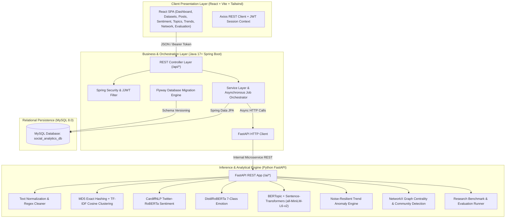

# System Architecture & Technical Specifications

## 1. Architectural Overview

**SocialLens** employs a decoupled three-tier microservice architecture designed for maintainability, security, and academic evaluation.



---

## 2. Component Boundaries & Responsibilities

### A. React Frontend (Port 5173)
- Built with **React 18**, **Vite**, **Tailwind CSS**, and **Lucide React**.
- Visualizations implemented via **Recharts** (Pie, Line, Bar charts) and dynamic SVG topology graph.
- Communicates **exclusively** with the Spring Boot backend (`http://localhost:8080/api`), maintaining architectural encapsulation.

### B. Spring Boot Main Backend (Port 8080)
- Built with **Java 17/23**, **Spring Boot 3.3.0**, **Spring Data JPA**, and **Spring Security**.
- Manages user authentication, BCrypt password hashing, and stateless JWT verification.
- Ingests tabular (CSV) and structured (JSON) datasets with schema mapping and preview.
- Orchestrates asynchronous analytics jobs via `AnalysisOrchestratorService`.
- Connects directly to **MySQL 8.0** with Flyway versioned database migrations.

### C. Python FastAPI AI Service (Port 8000)
- Built with **Python 3.13**, **FastAPI**, **Uvicorn**, **PyTorch**, **Transformers**, **Sentence-Transformers**, **BERTopic**, **scikit-learn**, and **NetworkX**.
- Operates as a stateless analytical engine with single-instance model caching during startup.
- Implements resilient fallbacks for zero-failure runtime guarantees.

---

## 3. Future Social Media API Connectors Interface

To comply with platform terms of service and avoid unauthorized scraping, the system defines clean abstract connectors for future authorized API additions:

```java
public interface SocialMediaConnector {
    String getPlatformName();
    boolean validateCredentials(Map<String, String> credentials);
    List<SocialPost> fetchAuthorizedPublicPosts(String query, int maxResults);
}
```

Authorized credentials (e.g., X API Bearer Token, Telegram Bot Token) are configured strictly via environment variables (`X_API_BEARER_TOKEN`, `TELEGRAM_BOT_TOKEN`), never hardcoded into source code.

