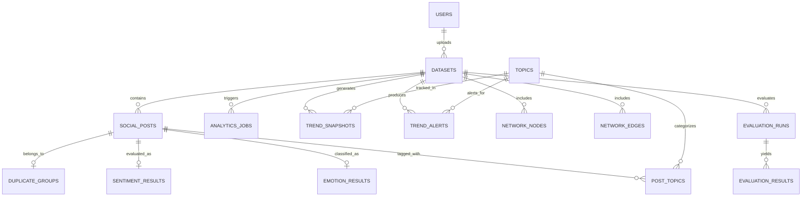

# Relational Database Design & Schema Specifications

## 1. Database Entity-Relationship Diagram

---

## 2. Table Specifications & Normalization

1. **`users`**: System credentials, BCrypt password hashes, and assigned security roles (`ADMIN`, `ANALYST`).
2. **`datasets`**: Tracks imported dataset files, format, total records, and status (`PENDING`, `PROCESSING`, `COMPLETED`, `FAILED`).
3. **`duplicate_groups`**: Records identified clusters of exact (MD5) or near-duplicate (TF-IDF cosine $\ge 0.85$) posts. Prevents coordinated bot campaigns from distorting volume.
4. **`social_posts`**: Normalized storage of individual social media posts with platform metadata, engagement counts, and duplicate flags.
5. **`sentiment_results`**: Stores CardiffNLP RoBERTa sentiment label (`POSITIVE`, `NEGATIVE`, `NEUTRAL`) and confidence probabilities.
6. **`emotion_results`**: DistilRoBERTa 7-class emotion classifications (`JOY`, `ANGER`, `SADNESS`, `FEAR`, `SURPRISE`, `DISGUST`, `NEUTRAL`) and full probability distribution JSON.
7. **`topics`**: Semantic clusters generated by BERTopic & Sentence-Transformers with extracted c-TF-IDF keywords.
8. **`post_topics`**: Weighted many-to-many junction table associating posts with semantic topics.
9. **`trend_snapshots`**: Time-window analytical records storing raw volume, unique volume, duplicate ratio, growth rate, rolling Z-score, and sentiment shift.
10. **`trend_alerts`**: Actionable alerts generated when statistical significance thresholds ($Z \ge 1.8$, Growth $\ge 50\%$) are met, with supporting post evidence IDs.
11. **`network_nodes`**: Graph nodes representing interaction accounts with calculated PageRank, betweenness centrality, and in/out degrees.
12. **`network_edges`**: Directed edges representing observable social interactions (replies, mentions).
13. **`analytics_jobs`**: Job tracking table recording progress percentage, started/completed timestamps, and error logs for asynchronous pipelines.
14. **`evaluation_runs`**: Historical experimental runs comparing baseline vs proposed methods against ground truth labels.
15. **`evaluation_results`**: Evaluation metrics (Precision, Recall, F1, False-Alert Rate, Detection Delay) across all 3 benchmark methods.
